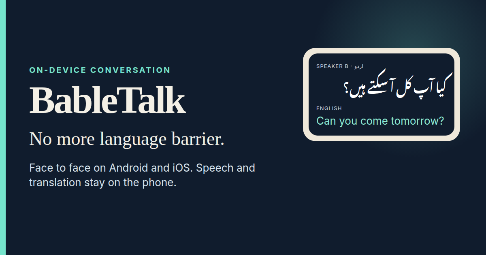

# BableTalk

**No more language barrier.**

BableTalk is a native Android and iOS face-to-face conversation assistant.
Two people share one phone, take turns, and read both languages before
anything is spoken aloud. After the speech and translation models are
prepared, conversation inference runs on the device. There is no account,
no API key, and no cloud speech or translation call in that path.

**Project page:** https://tajoor621.github.io/BableTalk/

<a href="https://tajoor621.github.io/BableTalk/"></a>

> **Status.** Development build. The physical-device checklist has not been
> passed. Treat the app as a working native project for development testing.
> It is not a certified interpreter, and no published model score is claimed
> as this application's accuracy.

## Contents

- [What a conversation does](#what-a-conversation-does)
- [Languages](#languages)
- [Privacy](#privacy)
- [Name](#name)
- [Requirements](#requirements)
- [Setup](#setup)
- [Models](#models)
- [Android test build](#android-test-build)
- [Offline check](#offline-check)
- [iOS](#ios)
- [Arabic dialect pack](#arabic-dialect-pack)
- [Storage](#storage)
- [Audio route](#audio-route)
- [Qualification](#qualification)
- [References](#references)

## What a conversation does

- 16 kHz mono PCM16 capture, with Silero ONNX streaming voice detection.
  Conversation mode keeps speech as short as 128 ms so a brief yes or no
  can survive.
- Multilingual quantised Whisper base for English, Urdu, and Arabic, plus
  experimental Pashto transcription.
- English, Urdu, and Arabic translate with each other through on-device
  ML Kit. Pashto translation is unavailable. An English pivot is not used
  to invent a missing Pashto model.
- Speaker A and speaker B are explicit. The phone does not guess who spoke.
  Both people use the phone microphone, including while headphones are
  connected.
- Stop & translate, bilingual text, correct-and-retranslate, typed turns,
  sentence-by-sentence system speech, and an explicit Play control.
  Recording stops before playback, so the speaker is not fed back into
  recognition.
- The translation aimed at you can play through headphones. Your reply
  plays on the phone speaker. If the private route fails, the app returns
  an error. You can choose the phone speaker for your own listening.
- Sessions are stored in private SQLite, including a session interrupted
  by a call or by leaving the app. Export is an explicit JSON or text
  share. Deletion is explicit. Audio stays in memory and is not written
  as a recording.
- Speech models download and repair in the app from immutable URLs, with
  size and SHA-256 checks. Translation packs are prepared on Wi-Fi. The
  app lists installed voices and surfaces actionable errors.
- Optional MMS-LID-126 audio language identification, with top-k scores
  and conservative ambiguity handling. Choosing each speaker's language
  by hand works without it.
- Optional Arabic dialect candidates from a build-generated Nawah ONNX
  pack, a verified byte-level BPE tokenizer, and accumulated text from
  the same speaker.
- Source CI, plus native Android and iOS build workflows. Read the current
  Actions run for build results. A JavaScript bundle or a mocked test does
  not certify behaviour on a phone.

Use one language per turn, and correct recognition before playing a
translation. Short or mixed Urdu and Hindi can be ambiguous. Names,
amounts, dates, and negation need a person to confirm them. MMS scores are
uncalibrated model scores. A confident language mismatch holds the
translation for review. It leaves the session's language pair as you set it.

The optional MMS checkpoint is about one billion parameters and about
974 MB in the quantised ONNX pack. It stays optional so a normal turn is
not forced to carry that latency and memory cost. Its licence is
CC-BY-NC-4.0. Read that restriction before enabling or distributing it.

Urdu, Pashto, and English have no dialect classifier here. Arabic dialect
labels need enough text from the same speaker. The model card warns about
inputs shorter than about 25 words. The app keeps the original Arabic. It
does not rewrite a dialect into Modern Standard Arabic from a lookup table.
Colloquial Arabic may need a rephrase in Modern Standard Arabic, or a
correction of the recognised words.

Nawah is optional, and its accuracy on a phone is still unqualified.
Specialised Urdu or Arabic Whisper checkpoints, and MOSS or Kitten voices,
are not part of this build. The running baseline is multilingual Whisper
plus whatever matching system voice is installed.

## Languages

| Language | Speech | Translation |
| --- | --- | --- |
| English | Multilingual Whisper base | On-device, with Urdu and Arabic |
| Urdu | Multilingual Whisper base | On-device, with English and Arabic |
| Arabic | Multilingual Whisper base | On-device, with English and Urdu. Optional dialect candidate after enough same-speaker text. |
| Pashto | Experimental transcription | Unavailable. Playback of a translation is unavailable. |

## Privacy

The schema is created by `src/storage/sessions.ts` through native SQLite.
SQL values are parameterised, and writes are serialised. A crash can leave
an open session and a pending utterance. Those remain visible in saved
history.

Android backup is disabled. iOS stores the database in an Application
Support folder excluded from backup and uses OS file protection. The app
does not add its own database encryption. Protect the device with a screen
lock. No audio is persisted. The most recent 500 turns are shown during a
session. The database retains the session record. The saved-session list
shows the latest 200. Only an explicit Export action opens the system
share sheet.

Ask both people before recording or saving their words.

## Name

The repository, this project page, and the product name are BableTalk.
The installed label, the npm package, and the application id still use the
earlier spelling BabelTalk (`com.babeltalk`). The Android development-test
artifact keeps that spelling in its name:
`BabelTalk-Android-development-test`.

## Requirements

- Node 22.11 or newer, npm, and Python 3.10 or newer
- Android: JDK 17, SDK and build-tools 36, NDK 27.1.12297006, CMake 3.22.1
- iOS: macOS, a compatible Xcode, CocoaPods, and iOS 16 or newer

Application id: `com.babeltalk`.

The project page is documentation. BableTalk does not run in the browser.
Capture and playback are native audio modules.

## Setup

```sh
npm ci
npm run typecheck
npm run lint -- --max-warnings=0
npm test
npm run android
# On macOS:
cd ios
pod install
cd ..
npm run ios
```

Open Models, download the speech models (about 62 MB: Silero plus
multilingual Whisper base, quantised), select the two languages, and
prepare the pair on Wi-Fi. ML Kit manages translation-model integrity
through its SDK. Those weights are not part of the open speech-model lock.
Playback needs a matching system voice. The translated text stays on screen
when a voice is missing. There is no speech-synthesis service key. Check
voice availability in airplane mode.

`npm ci` applies the reviewed compatibility changes in
`scripts/native-compat.cjs`: Gradle namespaces, pinned native ONNX Runtime,
telemetry opt-out, explicit phone-input selection, exact PCM byte counts,
and awaited capture shutdown. The input adapter is pinned. Review those
patches before changing dependency versions.

## Models

```sh
npm run models:download
python3 scripts/models.py verify
npm run models:android
# Optional, about 974 MB extra, non-commercial MMS licence:
python3 scripts/models.py download --mms
python3 scripts/models.py install-android --mms
```

Android `run-as` installation needs a debuggable build. Models go in the
app's private `files/models` directory. For an iOS development container,
use Xcode Devices and Simulators and place verified weights in
`AppData/Documents/models`. A booted simulator container can be located with:

```sh
xcrun simctl get_app_container booted com.babeltalk data
```

Most people should use the in-app downloader instead.

MMS is already ONNX in the pinned Xenova pack. Silero is already ONNX.
Whisper is already GGML quantised. Those locked files do not need a
conversion step. The original English-only model remains supported by the
pipeline default and by the developer model installer.

## Android test build

For an independent Android test build with embedded JavaScript:

```sh
cd android
./gradlew assembleRelease -PreactNativeArchitectures=arm64-v8a
adb install -r app/build/outputs/apk/release/app-release.apk
```

The template uses the public development signing key. This is a
development-test APK. Replace the signing, and finish privacy, licence, and
device qualification, before public distribution. GitHub Actions uploads
that test APK when the native workflow succeeds. The artifact is retained
for seven days.

## Offline check

The `offlineQa` variant removes the Android `INTERNET` permission and is
debuggable, so speech weights can be preloaded with `npm run models:android`.
Prepare ML Kit translation packs before a network-denied test. A normal
release still allows the explicit first-run model downloads.

The inference path does not call a model downloader or a cloud translator.
SDK operational metadata is covered by Google's SDK terms. The app does not
pass a transcript to a network translation endpoint. Confirm the network
behaviour during device qualification.

## iOS

On a Mac, install pods and run the app with the commands in
[Setup](#setup). The native workflow builds an unsigned iOS binary
(`CODE_SIGNING_ALLOWED=NO`). That job is a compile check. It is not an
App Store package.

## Arabic dialect pack

Native CI generates and bundles the pinned Apache-2.0 Nawah model. It does
not execute the model repository's Python. The licence text shipped with
that preparation is `docs/licenses/Nawah-Apache-2.0.txt`. Locally, before a
native build, generate the same pack with:

```sh
python3 -m pip install torch==2.6.0 --index-url https://download.pytorch.org/whl/cpu
python3 -m pip install transformers==4.49.0 onnx==1.17.0 onnxruntime==1.24.3
python3 scripts/export_nawah.py
npm test -- bpe
```

The script checks source hashes, reconstructs the mean-pooling classifier,
compares ONNX and PyTorch logits, and writes `generated-assets/nawah`. The
mobile tokenizer is tested against reference token ids. Model weights stay
out of git. Enable Arabic dialect candidates in Models. A missing or corrupt
pack shows a warning and leaves translation available.

Labels require at least 25 words from the same speaker, a model score of at
least 0.8, and a top-two margin of at least 0.2. Those thresholds are
provisional. They are not an independent accuracy calibration. Urdu and
Pashto do not receive dialect labels.

ONNX telemetry is disabled at process startup and before the native
environment is created. The Python conversion opts out before importing the
runtime.

## Storage

See [Privacy](#privacy). Saved history remains the place to recover a
session that was open when the app was interrupted.

## Audio route

The phone microphone is requested and checked for both turns, including
while headphones are connected. Native start and stop are awaited. The
screen stays awake only while a session is active. The build does not assume
two simultaneous physical inputs. Android 12 and newer can select a
communication device. Android 7 through 11 in this build support explicit
wired output. Legacy Bluetooth routing still needs device-specific work.
iOS uses `AVAudioSession` output overrides and checks that the private
output exists.

The app stops recording when it is backgrounded or interrupted. Worth
exercising on a device: phone calls, screen locks, unplugging a headset,
Bluetooth changes, rapid taps, and low memory. A wait under three seconds,
and a one-hour session, are targets. They are not measured results. Pashto
speech quality is experimental. Do not substitute a model paper's word-error
rate for a conversation on this app.

## Qualification

Follow `docs/DEVICE_ACCEPTANCE.md` on a physical Android phone and on an
iPhone before calling a capability device-qualified. `docs/VALIDATION.md`
records which development checks have been run and which have not.

Source verification:

```sh
npm ci
npm run typecheck
npm run lint -- --max-warnings=0
npm test
```

## References

- https://developers.google.com/ml-kit/language/translation/android
- https://developers.google.com/ml-kit/language/translation/ios
- https://developers.google.com/ml-kit/language/translation/translation-language-support
- https://huggingface.co/facebook/mms-lid-126
- https://huggingface.co/Xenova/mms-lid-126
- https://huggingface.co/oddadmix/Nawah-Dialect-BERT-6M
- https://github.com/mybigday/whisper.rn
- https://github.com/snakers4/silero-vad
- https://huggingface.co/ggerganov/whisper.cpp

ML Kit and system speech are the on-device engines in this build. They are
practical mobile components. They are not a Python or LibreTranslate server,
and the app does not bridge a transcript to a laptop or a LAN service.

## Licence

This repository does not include a licence file. Publishing the source does
not, by itself, grant a licence to reuse it. Bundled and downloaded models
keep the terms named in the lock files and in the sections above.
